# Langkah Kerja Praktikum 6 - Pemrogramman Web

# Latihan - 1
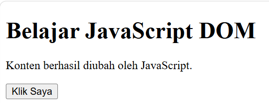

# Latihan - 2
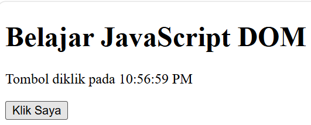

# Latihan - 3
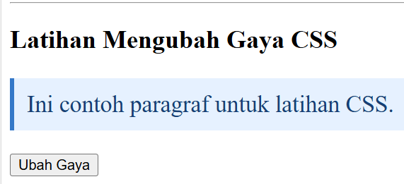

# Latihan - 4
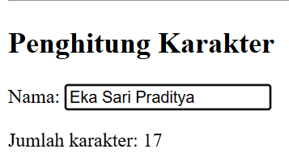

# Latihan - 5
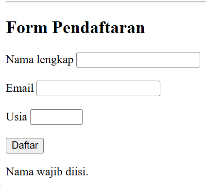
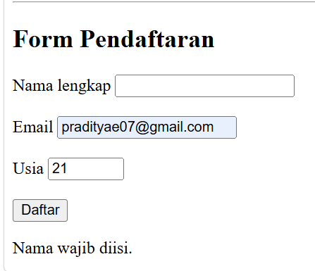
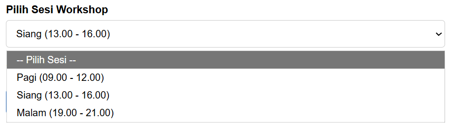
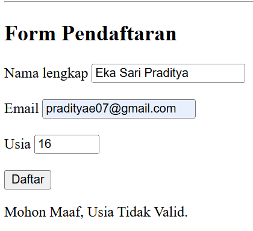
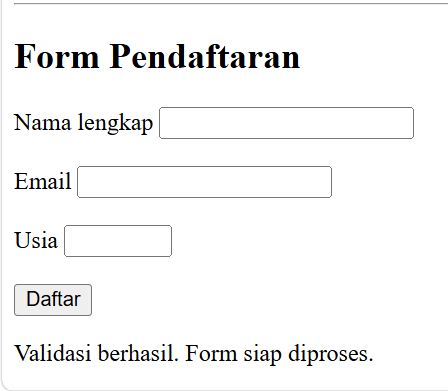

# Latihan - 6
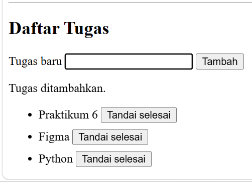

# Mini Project - Pendaftaran WorkShop beserta Eksperimen Mnadiri

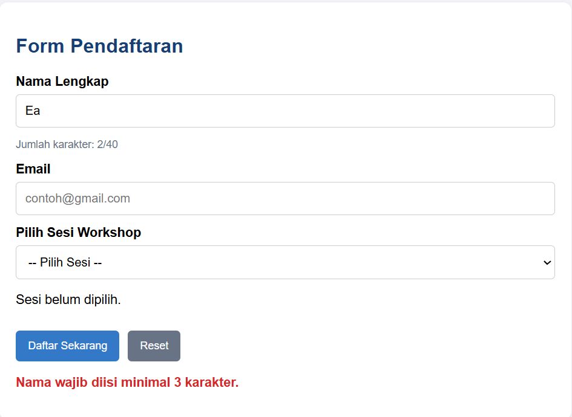

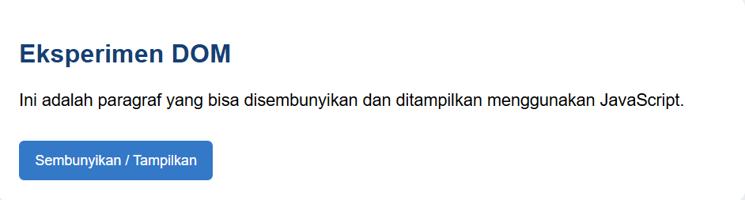
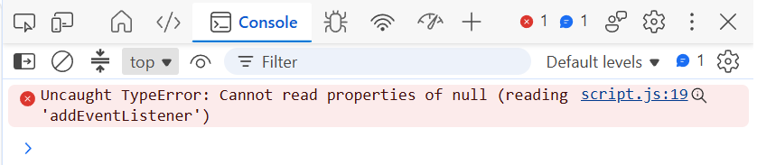

Kenapa Eksperimen 5 Eror? Karena JavaScript dijalankan saat browser masih membaca bagian <head>, sedangkan elemen HTML seperti tombol, input, dan paragraf belum dibuat.

Akibatnya, JavaScript bisa gagal menemukan elemen HTML tersebut (null).

# Pertanyaan Evaluasi

**1. Apa yang dimaksud dengan DOM dan apa manfaatnya?**

DOM (Document Object Model) adalah struktur yang dibuat browser dari dokumen HTML sehingga JavaScript bisa mengakses dan mengubah elemen HTML. Manfaatnya adalah untuk mengubah teks, mengatur tampilan, menambahkan elemen, dan membuat halaman web menjadi lebih interaktif.

**2. Apa perbedaan getElementById(), querySelector(), dan querySelectorAll()?**

- `getElementById()` digunakan untuk memilih satu elemen berdasarkan ID.
- `querySelector()` digunakan untuk memilih elemen pertama yang cocok dengan selector CSS.
- `querySelectorAll()` digunakan untuk memilih semua elemen yang cocok dengan selector CSS.

**3. Apa fungsi addEventListener() dan sebutkan tiga contoh event?**

`addEventListener()` berfungsi untuk menjalankan kode JavaScript ketika suatu event atau tindakan terjadi pada elemen HTML.

Contoh event:
- `click`: ketika elemen diklik.
- `input`: ketika pengguna mengetik atau mengubah isi input.
- `submit`: ketika formulir dikirim.

**4. Mengapa event.preventDefault() digunakan pada event submit form?**

`event.preventDefault()` digunakan untuk mencegah tindakan bawaan browser saat form dikirim, seperti memuat ulang halaman. Dengan begitu, JavaScript bisa melakukan validasi data terlebih dahulu sebelum form diproses.

**5. Apa perbedaan textContent dan innerHTML dari sisi penggunaan dan keamanan?**

- `textContent` digunakan untuk mengambil atau mengubah teks pada elemen. Isinya dianggap sebagai teks biasa sehingga lebih aman untuk menampilkan input dari pengguna.
- `innerHTML` digunakan untuk mengambil atau mengubah isi HTML, termasuk tag HTML. Namun, penggunaannya perlu hati-hati karena HTML yang berasal dari input pengguna bisa menimbulkan risiko serangan XSS.

**6. Bagaimana classList.toggle() membantu mengubah tampilan elemen?**

`classList.toggle()` digunakan untuk menambahkan class CSS jika class tersebut belum ada, atau menghapusnya jika sudah ada. Dengan begitu, tampilan elemen bisa diubah secara bergantian, misalnya menyembunyikan dan menampilkan paragraf atau mengubah warna teks.

**7. Sebutkan minimal tiga skenario pengujian validasi form.**

1. Form dikirim dalam keadaan kosong. Hasilnya, sistem menampilkan pesan bahwa data wajib diisi.
2. Nama diisi kurang dari 3 karakter. Hasilnya, sistem menampilkan pesan bahwa nama minimal harus 3 karakter.
3. Email diisi dengan format yang salah. Hasilnya, sistem menampilkan pesan bahwa email tidak valid.
4. Sesi workshop belum dipilih. Hasilnya, sistem meminta pengguna memilih sesi terlebih dahulu.
5. Semua data diisi dengan benar. Hasilnya, sistem menampilkan pesan bahwa pendaftaran berhasil dan ringkasan data pendaftaran.